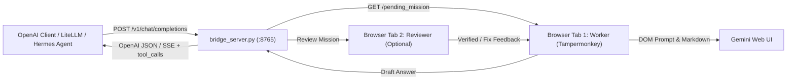

# LLM Web Bridge (Gemini Dual-Agent & OpenAI-Compatible Bridge)

Turn an open **Google Gemini** browser session into an **OpenAI-compatible API endpoint** (`/v1/chat/completions`), complete with **ReAct `tool_calls` emulation**, **Dual-Tab Worker + Reviewer anti-hallucination verification**, **image generation (`POST /generate_image`)**, and **SQLite telemetry + model cooldown tracking**.

> **Disclaimer:** Experimental personal automation / research bridge. Using web UIs programmatically may violate provider Terms of Service. No credentials, API keys, or personal data are included in this repository.

## Architecture



## Key Features

- **OpenAI-Compatible API (`POST /v1/chat/completions`)**
  - Supports both standard JSON and SSE streaming (`stream: true`) for LiteLLM, OpenWebUI, and agent frameworks like Hermes.
  - Emulates OpenAI **`tool_calls`** (ReAct loop): injects available tool schemas, parses structured JSON tool calls from the model response, and feeds `role: "tool"` outputs back into the browser session.
  - 5-minute in-memory response cache (`RESPONSE_CACHE`) for repeated non-tool prompts and `503` guard when no active `worker`/`coder` browser tab is registered.
- **Dual-Tab Worker + Reviewer Anti-Hallucination Loop**
  - Assign browser tabs via the compact Tampermonkey toolbar (`solo`, `worker`, `coder`, `image`, `canvas`, `research`, `reviewer`).
  - Auto-role assignment (`worker` → `image` → `solo`) when opening multiple tabs.
  - When a `reviewer` tab is active, the `worker` draft is cross-checked against actual tool outputs to catch guessed filenames, ports, or services before returning the final answer.
- **DOM-to-Markdown Converter (`domToMarkdown`)**
  - Preserves headings, bullet/numbered lists, bold/italic formatting, code blocks, and GFM Markdown tables (`| col | ... |`) from Gemini's rendered DOM.
- **Image Generation Endpoint (`POST /generate_image` & `GET /images/<file>`)**
  - Routes image prompts to a dedicated `image` tab (or `worker`/`solo` fallback), extracts generated images, and saves them locally.
- **Telemetry & Cooldown Auto-Recovery (`SQLite`)**
  - Tracks per-model runs, latency, approximate tokens, and rate-limit cooldowns in `bridge_stats.db` with a live web dashboard at `http://localhost:8765/`.

## Quick Start

### 1. Start the Bridge Server

```bash
python3 bridge_server.py
```

Optional environment variables:
- `BRIDGE_PUBLIC_HOST` (default: `localhost`) — Hostname/IP returned in `image_url` responses.
- `BRIDGE_SYSTEM_PROMPT` — Custom system context prepended to `/v1/chat/completions` prompts.

The server listens on `0.0.0.0:8765` (Dashboard: `http://localhost:8765/`).

### 2. Install the Tampermonkey Userscript

1. Install **Tampermonkey** in Chrome/Chromium.
2. Create a new userscript and paste/require `userscript/gemini-dual-agent.user.js`.
3. Open [gemini.google.com](https://gemini.google.com/) — the compact toolbar appears at the top.
4. Optionally open a **second tab** on `gemini.google.com` and set its role to **`🧐 Reviewer`** for automatic draft verification.

### 3. Connect via LiteLLM or Any OpenAI Client

See `examples/litellm_config.example.yaml` and `examples/hermes_profile.example.yaml`, or test directly:

```bash
curl -s http://localhost:8765/v1/chat/completions \
  -H "Content-Type: application/json" \
  -d '{
    "model": "gemini-browser",
    "messages": [{"role": "user", "content": "Hello from the bridge!"}]
  }'
```

## License

MIT — see [LICENSE](LICENSE).
